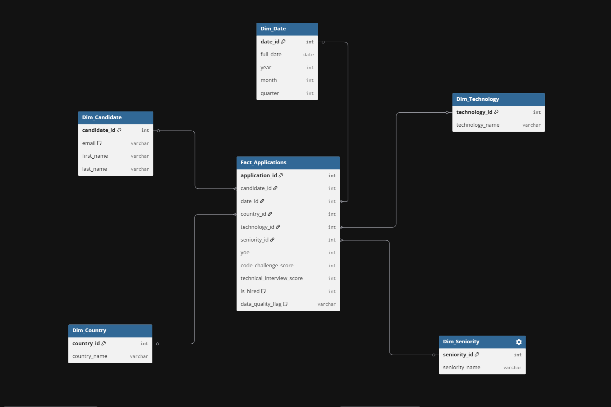

# Hiring Analytics Warehouse

Raw candidate applications go in. A star-schema warehouse and a hiring dashboard come out. Every report is queried from the warehouse, not from the source file.

**Demo:** [hiring dashboard](https://emxxlenis.github.io/recruitment-etl-data-warehouse/)

## What the business can answer

- Where hires concentrate, by technology, seniority, country, and year
- The hire rate, and the technical bar of the people who pass
- Which rows are safe to use and which look wrong, without deleting history

On the run documented with this model: about 50,000 applications, about 6,698 hires, a 13.4% hire rate, and an average technical score near 8.5/10 among hires.

## Stack

| Layer | Choice |
|---|---|
| Language | Python 3.8+ |
| Transform | pandas |
| Warehouse | SQLite, loaded through SQLAlchemy |
| BI | Power BI, connected to the warehouse |
| Checks | SQL KPI queries plus a consistency script |

The same dimensional model can move to PostgreSQL. SQLite is the local warehouse so the pipeline runs with one command.

## Model

`fact_applications` holds one row per application.

- Surrogate keys on every dimension
- Candidate identity deduplicated by email, while every application stays in the fact
- A date dimension for year, month, and quarter



## Pipeline

`src/extract.py` reads `data/raw/candidates.csv`, checks the required columns, and rejects values that are not dates or numbers before any rule runs.

`src/transform.py` applies the hiring rule and the quality flags, then builds the dimensions and the fact.

- Hired when the code challenge score is at least 7 and the technical interview score is at least 7
- Suspicious rows are labeled, not dropped. Examples: an intern with more than 5 years of experience, a score outside the valid range

`src/load.py` loads dimensions first, then the fact, in a transaction.

## Quality views

The dashboard exposes one selector over the same warehouse:

| View | What it includes |
|---|---|
| All | Clean and flagged rows |
| Clean | Only rows flagged `Clean` |
| Flagged | Everything that failed a quality rule |


## KPI layer

Queries in `sql/queries/` run against the warehouse:

1. Hires by technology
2. Hires by year
3. Hires by seniority
4. Hires by country
5. Hire rate
6. Technical scores of hired candidates

Each query can split `total_hires`, `clean_hires`, and `flagged_hires`. KPI totals are checked against each other and against `fact_applications`.

## Run it

```bash
python -m venv .venv
source .venv/bin/activate
pip install -r requirements.txt
python src/setup.py
python src/main.py
python tests/run_kpi_checks.py
```

Place the source file at `data/raw/candidates.csv`. The warehouse is written to `sql/hiring_analytics.db`.

## Repository

```text
data/raw/            source extract
src/                 extract, transform, load
sql/                 schema, KPI queries, warehouse file
sql/queries/         business KPIs
tests/               KPI consistency checks
diagrams/            model and dashboard views
docs/                public walkthrough of the dashboard
```
