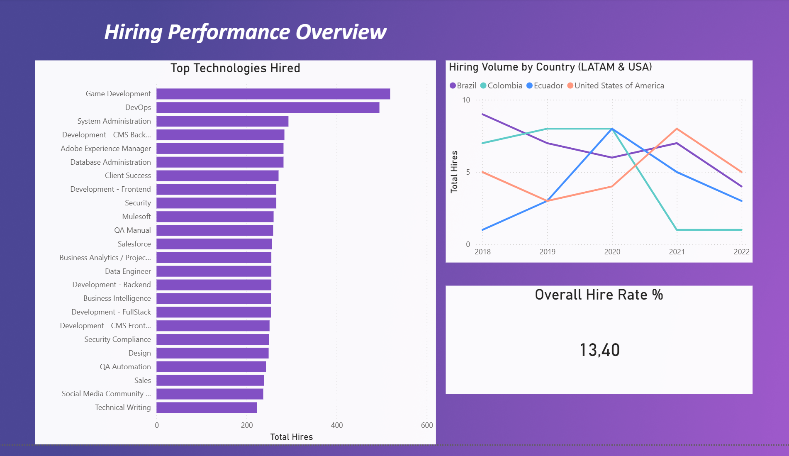
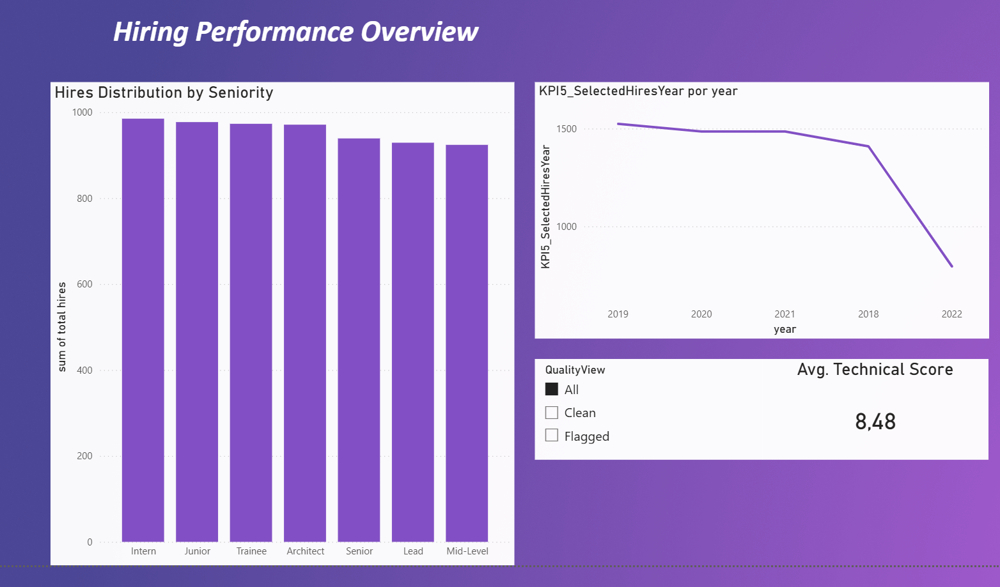
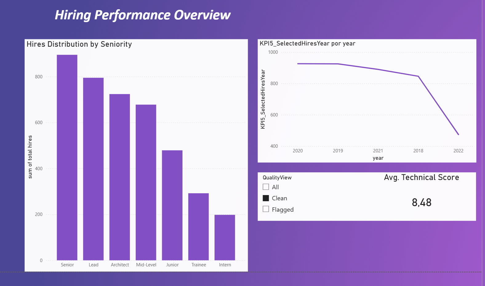
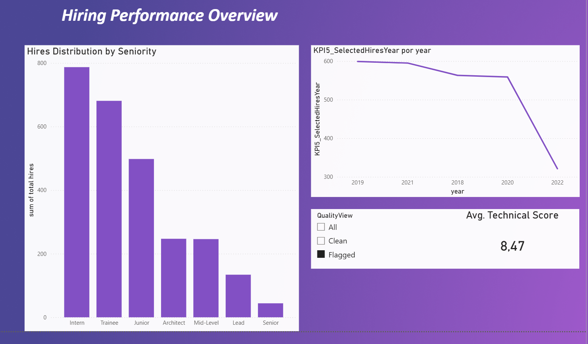

# Recruitment ETL Data Warehouse Project

A complete, production-oriented ETL pipeline for candidate application analytics using a Star Schema and SQL-based KPI reporting.

## Table of Contents

- [1. Project Objective](#1-project-objective)
- [2. Scope and Requirements Alignment](#2-scope-and-requirements-alignment)
- [3. Technology Stack](#3-technology-stack)
- [4. Data Model (Star Schema)](#4-data-model-star-schema)
- [5. ETL Pipeline Design](#5-etl-pipeline-design)
- [6. Data Quality Strategy](#6-data-quality-strategy)
- [7. KPI Layer (SQL from DW)](#7-kpi-layer-sql-from-dw)
- [8. Dashboard Behavior (All/Clean/Flagged)](#8-dashboard-behavior-allcleanflagged)
- [9. How to Run](#9-how-to-run)
- [10. Validation and Expected Outputs](#10-validation-and-expected-outputs)
- [11. Repository Structure](#11-repository-structure)

---

## 1. Project Objective

This project implements a full ETL process (Extract, Transform, Load) to migrate candidate application data from a raw CSV into an analytical Data Warehouse.

The objective is to transform denormalized source data into a dimensional model (Star Schema) that supports reliable KPI analysis in BI tools. All reports are generated from the Data Warehouse, never directly from the CSV.

---

## 2. Scope and Requirements Alignment

This implementation is aligned with the workshop requirements:

- One fact table + multiple dimensions.
- Surrogate keys in dimension tables.
- Explicit fact-table grain definition.
- ETL logic implemented in Python.
- Business hiring rule implemented during transformation.
- Data quality handling without dropping records.
- SQL KPI queries executed from the Data Warehouse.
- BI visualizations based on DW outputs.

---

## 3. Technology Stack

- **Language:** Python 3.8+
- **Data Processing:** pandas
- **SQL Layer:** SQLAlchemy
- **Data Warehouse:** SQLite (`sql/etl_workshop.db`)
- **BI Tool:** Power BI (ODBC connection)
- **Version Control:** Git / GitHub

---

## 4. Data Model (Star Schema)

The analytics model follows a Star Schema centered on `fact_applications`.


### Modeling decisions

- **Fact grain:** one row per candidate application.
- **Surrogate keys:** integer keys for all dimensions (`*_id`).
- **Candidate identity:** deduplicated at dimension level using email as business key while preserving all application events in the fact table.
- **Date dimension:** supports year/month/quarter analytics.

### Why this model

- Simplifies BI joins and aggregations.
- Decouples analytics from source-system volatility.
- Supports scalable metric expansion over time.

---

## 5. ETL Pipeline Design

Pipeline modules:

- `src/extract.py`
- `src/transform.py`
- `src/load.py`
- `src/main.py`

### Extract

- Loads `data/raw/candidates.csv`.
- Validates required columns.
- Validates data types:
  - `Application Date` parseable as date.
  - `YOE`, `Code Challenge Score`, `Technical Interview Score` numeric.

### Transform

- Applies hiring rule:
  - `is_hired = 1` when `Code Challenge Score >= 7` and `Technical Interview Score >= 7`.
- Builds dimensions and assigns surrogate keys.
- Produces `fact_applications` aligned to defined grain.
- Applies quality flags without deleting rows.

### Load

- Loads dimensions first, then fact table.
- Uses transactional operations and chunked insert strategy.
- Preserves referential integrity.

---

## 6. Data Quality Strategy

The project uses `data_quality_flag` to preserve full data volume while enabling controlled analysis views.

Examples of flags:

- `Suspicious: Intern with >5 YOE`
- `Suspicious: Trainee with >8 YOE`
- `Suspicious: Junior with >15 YOE`
- `Suspicious: Mid-Level with >22 YOE`
- `Suspicious: Senior with <2 YOE`
- `Invalid Score Range`
- `Clean`

### Key principle

No records are deleted for quality anomalies. Instead, data is labeled for:

- full-volume reporting (`All`),
- quality-constrained reporting (`Clean`),
- anomaly-focused auditing (`Flagged`).

---

## 7. KPI Layer (SQL from DW)

KPI SQL files are located in `sql/queries/`:

1. `kpi1_hires_by_technology.sql`
2. `kpi2_hires_by_year.sql`
3. `kpi3_hires_by_seniority.sql`
4. `kpi4_hires_by_country.sql`
5. `kpi5_hire_rate_percentage.sql`
6. `kpi6_hired_quality_scores.sql`

These queries are executed directly against the Data Warehouse and include quality segmentation where applicable:

- `total_hires`
- `clean_hires`
- `flagged_hires`

---

## 8. Dashboard Behavior (All/Clean/Flagged)

Power BI consumes DW-backed KPI outputs and exposes a quality selector (`QualityView`):

- **All:** includes clean + flagged records.
- **Clean:** includes only `data_quality_flag = 'Clean'`.
- **Flagged:** includes only non-clean records.

### Dashboard screenshots

**Overview page**



**QualityView = All**



**QualityView = Clean**



**QualityView = Flagged**



---

## 9. How to Run

### Prerequisites

- Python 3.8+
- pip

### Setup

```bash
python -m venv .venv
.\.venv\Scripts\Activate.ps1
pip install -r requirements.txt
```

### Initialize schema

```bash
python src/setup.py
```

### Execute full ETL

```bash
python src/main.py
```

Database output location:

- `sql/etl_workshop.db`

### Validate KPI outputs

```bash
python tests/run_kpi_checks.py
```

---

## 10. Validation and Expected Outputs

After a successful ETL run, expected high-level outputs are:

- Fact table rows: ~50,000
- Hired applications: ~6,698
- Overall hire rate: ~13.4%
- Average hired technical scores: ~8.5/10

Consistency validation:

- KPI1 total hires sum = KPI2 total hires sum = KPI3 total hires sum = total hired count in `fact_applications`.

---

## 11. Repository Structure

```text
etl-workshop-1/
├── data/
│   ├── raw/
│   └── processed/
├── diagrams/
│   ├── star_schema.png
│   ├── vista_1.png
│   ├── vista_2_all.png
│   ├── vista_2_clean.png
│   └── vista_2_flagged.png
├── notebooks/
│   └── eda.ipynb
├── sql/
│   ├── create_tables.sql
│   ├── load_tables.sql
│   ├── etl_workshop.db
│   └── queries/
├── src/
│   ├── config.py
│   ├── db.py
│   ├── extract.py
│   ├── transform.py
│   ├── load.py
│   ├── setup.py
│   ├── main.py
│   └── check_data.py
├── tests/
│   └── run_kpi_checks.py
├── .gitignore
├── requirements.txt
└── README.md
```

---


